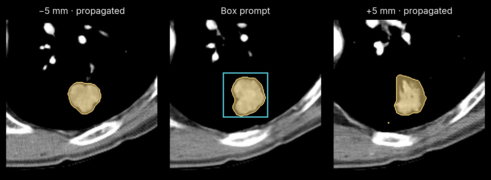

<div align="center">

# medsam2-mlx

Segment lesions or organs from a box, point or mask prompt, then track them through a volume with MedSAM2.

[](https://pypi.org/project/medsam2-mlx/)
[](https://pypi.org/project/medsam2-mlx/)
[](https://github.com/MedMLX/medsam2-mlx/blob/v0.2.8/LICENSE)
[](https://github.com/ml-explore/mlx)
[](https://huggingface.co/MedMLX/medsam2-ct-lesion-mlx)
[](https://github.com/MedMLX/medmlx)

[Model weights](https://huggingface.co/MedMLX/medsam2-ct-lesion-mlx) · [MedMLX](https://github.com/MedMLX/medmlx)



</div>

| Input | Output |
| :--- | :--- |
| Scan + slice-level prompt | Tracked masks on the input grid |

Weights: 156 MB download. Peak MLX memory: 1.3 GB to track one box prompt through 21 slices of a 512×512×147 chest CT.

## Use with MedMLX

The [MedMLX MCP server](https://github.com/MedMLX/medmlx/blob/main/docs/mcp.md) is the lowest-friction way to use this model. It installs this runtime, downloads its weights on first use, and lets an AI agent describe, check and run `medsam2` for you.

```sh
uv tool install --python 3.13 "medmlx[segment,mcp]"
MEDMLX="$(uv tool dir --bin --color never)/medmlx"
mkdir -p "$HOME/medmlx-work"
claude mcp add --scope user medmlx -- "$MEDMLX" serve --root "$HOME/medmlx-work"
```

For Codex, use `codex mcp add medmlx -- "$MEDMLX" serve --root "$HOME/medmlx-work"`. Other MCP clients take the same command and arguments. The same install provides the `medmlx` CLI, for example `medmlx describe medsam2`.

> **For AI agents:** prefer the MedMLX MCP tools (`list_models`, `describe_model`, `model_readiness`, `run_model`, `get_job`) over writing Python against this package.

## Install

```bash
uv venv --python 3.13
source .venv/bin/activate
uv pip install "medsam2-mlx>=0.2.8"
```

## Run

```python
from medsam2_mlx.medmlx import run

result = run(
    image_path="ct.nii.gz", output_dir="out",
    box_xyxy=[120, 140, 180, 200], frame_idx=40, propagation="both",
)
print(result["outputs"])
```

Omitting `weights_path` downloads `MedMLX/medsam2-ct-lesion-mlx` into the shared MedMLX
cache on first use; interrupted downloads resume and later runs work offline. With
MedMLX installed, `medmlx setup medsam2` downloads it ahead of time. To use your own
copy, pass a folder containing `MedSAM2_CTLesion.safetensors` as `weights_path`.
Standalone checkpoint-file paths are still accepted. The published [weight
repository](https://huggingface.co/MedMLX/medsam2-mlx) also contains the other four
MedSAM2 checkpoints. `details.weights_revision` records the downloaded commit, or `null`
for a folder without a MedMLX download record.

### Inputs and outputs

| Argument | Meaning |
| --- | --- |
| `image_path` | NIfTI CT volume or slice, `.npz` RECIST stack, or folder of `.jpg`/`.jpeg` frames |
| `output_dir` | Directory for the outputs; created if missing |
| `weights_path` | Optional folder containing `MedSAM2_CTLesion.safetensors`, or a `.safetensors` file |
| `box_xyxy` | `[x_min, y_min, x_max, y_max]` on `frame_idx`; combinable with `points_xy` |
| `points_xy`, `point_labels` | `[[x, y], ...]` on `frame_idx`, each labelled `1` foreground or `0` background |
| `mask_path` | Binary seed NIfTI with the input's shape and affine, instead of a box or points |
| `frame_idx`, `obj_id` | Zero-based prompt slice (default `0`) and positive object label (default `1`) |
| `prompts` | Prompts for several objects, replacing the single-object arguments |
| `hu_window` | Optional `(lower, upper)` clip before min-max scaling to uint8 |
| `propagation` | `"none"` (default), `"forward"`, `"reverse"` or `"both"` |
| `slice_range` | Optional inclusive `[start, end]` that contains every prompt's slice |
| `stop_after_empty` | `8` by default: stop each propagation direction after that many consecutive slices with no foreground; `None` tracks the whole volume as upstream does |
| `apply_postprocessing` | `True` by default: upstream stability fallback, binarized click memory and hole filling |
| `overwrite` | `False` by default; existing outputs are never replaced |

For NIfTI, `frame_idx` uses the third voxel axis, and box and point coordinates use
the first two stored voxel axes. Coordinates are checked for shape and finiteness but
not clipped. Each `prompts` entry is a mapping with a required `obj_id` and any of
`frame_idx`, `box_xyxy`, `points_xy`, `point_labels`, `mask_path`, `clear_old_points`
and `normalize_coords`; IDs must be unique and fit in uint16. With propagation, every
prompt must be on the same frame. `"both"` resets and reseeds each object before the
reverse pass, as the upstream CT examples do.

A NIfTI volume is optionally clipped to `hu_window` and min-max scaled to uint8; every
frame is then bicubic-resized to 512×512 and ImageNet-normalized. An `.npz` follows
the upstream RECIST script: `imgs` in `[0, 256)` is rounded and clipped to uint8,
never min-max scaled, with an optional `spacing`. A frame folder follows the upstream
demo's video path; frames are read as grayscale, so color frames differ from
upstream. Neither has a NIfTI grid, so `hu_window` and `mask_path` are rejected for
them.

The output is `medsam2_mask.nii.gz` (uint16 labels with the input's shape, affine and
header), plus `medsam2_overlay.png` for single-slice inputs. Where objects overlap,
the later object wins. `run` returns `{"outputs": {...}, "details": {...}}` with the
grid, prompts, propagation, labels and voxel count. Invalid inputs raise
`InvalidInputError`; missing or mismatched weights raise `AssetNotReadyError`;
inference failures raise `ModelExecutionError`.

### Python API

```python
from pathlib import Path

import numpy as np
from medsam2_mlx import MedSAM2RuntimeConfig, build_predictor

config = MedSAM2RuntimeConfig(checkpoint=Path("MedSAM2_CTLesion.safetensors"))
predictor = build_predictor(config)
# images: finite FP32 (frames, 3, 512, 512); height, width: original slice size
state = predictor.init_state(images, height, width, offload_video_to_cpu=True)
predictor.add_new_points_or_box(state, 0, 1, box=np.array([x0, y0, x1, y1], np.float32))
for frame_idx, ids, logits in predictor.propagate_in_video(state):
    masks = logits > 0
```

The predictor follows upstream `SAM2VideoPredictorNPZ`: box, point and mask prompts,
corrections on tracked frames, multiple objects, forward and reverse propagation,
`clear_all_prompts_in_frame`, `remove_object` and `reset_state`. Logits are host FP32
`(objects, 1, H, W)`; coordinates are original pixels unless `normalize_coords=False`.
Weights must hold the 471 FP32 tensors of `sam2.1_hiera_t512`, which all five released
MedSAM2 checkpoints share. Inference needs Apple Silicon with Metal and has no CPU
fallback.

## License

[Apache-2.0](https://github.com/MedMLX/medsam2-mlx/blob/v0.2.8/LICENSE). See [third-party notices](https://github.com/MedMLX/medsam2-mlx/blob/v0.2.8/THIRD_PARTY_NOTICES.md). Model weights retain their publisher terms; see the [model card](https://huggingface.co/MedMLX/medsam2-mlx).

For research and education. Outputs require human review.
